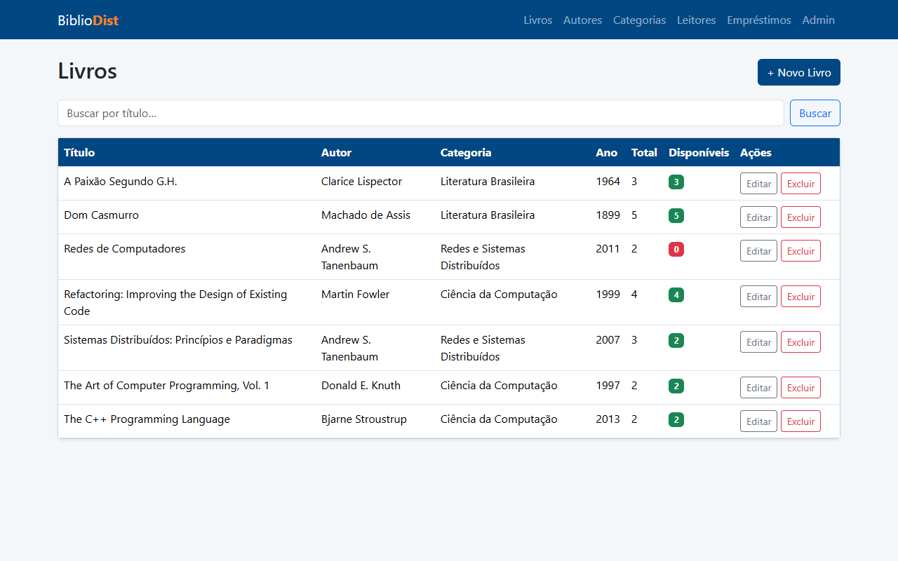
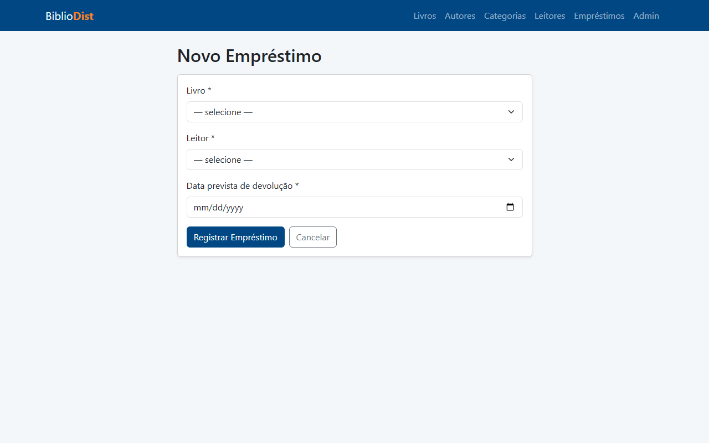
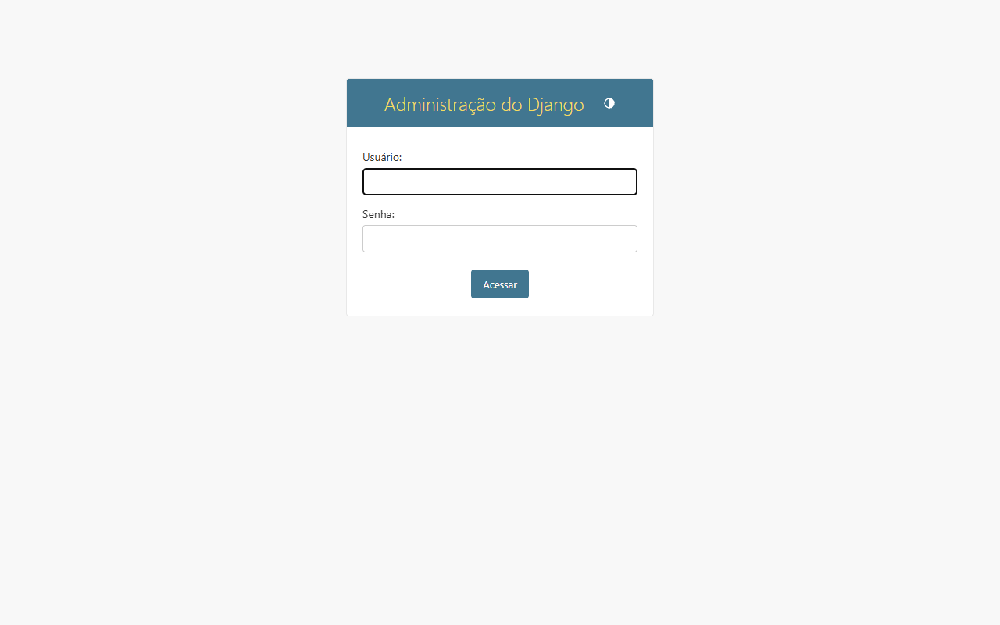

# BiblioDist — Sistema de Gerenciamento de Biblioteca Distribuída

**Disciplina:** Sistemas Distribuídos  
**Professor:** Almir Camolesi  
**Instituição:** FEMA — Fundação Educacional do Município de Assis  
**Aluno:** Arthur Naoto Miura  
**RA:** 2311600029  
**Data:** Novembro de 2026  

---

## Sumário

1. [Objetivo e Contexto](#1-objetivo-e-contexto)
2. [Aderência aos Requisitos do Trabalho](#2-aderência-aos-requisitos-do-trabalho)
3. [Arquitetura do Sistema](#3-arquitetura-do-sistema)
4. [Tecnologias e Bibliotecas Utilizadas](#4-tecnologias-e-bibliotecas-utilizadas)
5. [Fase 1 — Domínio da Biblioteca](#5-fase-1--domínio-da-biblioteca)
6. [Fase 2 — Serviço gRPC](#6-fase-2--serviço-grpc)
7. [Fase 3 — Mensageria com RabbitMQ](#7-fase-3--mensageria-com-rabbitmq)
8. [Fase 4 — Containerização com Docker](#8-fase-4--containerização-com-docker)
9. [Fase 5 — Relatório Acadêmico](#9-fase-5--relatório-acadêmico)
10. [Fase 6 — Acervo Real e Identidade Visual FEMA](#10-fase-6--acervo-real-e-identidade-visual-fema)
11. [Fase 7 — Revisão Sistemática PRISMA 2020](#11-fase-7--revisão-sistemática-prisma-2020)
12. [Deploy em Nuvem — Coolify](#12-deploy-em-nuvem--coolify)
13. [Como Executar o Sistema](#13-como-executar-o-sistema)
14. [Telas do Sistema](#14-telas-do-sistema)
15. [Conclusão e Aprendizados](#15-conclusão-e-aprendizados)

---

## 1. Objetivo e Contexto

O projeto **BiblioDist** foi desenvolvido como trabalho prático da disciplina de Sistemas Distribuídos. O objetivo é construir um sistema de gerenciamento de biblioteca que demonstre na prática os principais paradigmas de comunicação distribuída:

- **HTTP/REST** — comunicação síncrona entre cliente e servidor web
- **RPC com gRPC** — chamada remota de procedimento entre microsserviços
- **Mensageria assíncrona com RabbitMQ** — desacoplamento via filas de mensagens

O sistema gerencia o **acervo real da Biblioteca da FEMA** (12.044 livros, 36.452 exemplares), integra os três mecanismos de comunicação em um fluxo coeso e oferece ainda uma ferramenta de **Revisão Sistemática PRISMA 2020** sobre os TCCs do Acervo Digital da instituição.

---

## 2. Aderência aos Requisitos do Trabalho

> *"Desenvolver uma aplicação que use pelo menos 3 dos conceitos: SOA, Webservice (SOAP), Webservice (REST), Conceitos de Computação em Nuvem, Conceitos de DevOps, Microserviços, Docker, Kubernetes, MCP, outros."*

O BiblioDist implementa **6 dos conceitos** solicitados:

### Docker ✅

Todos os serviços rodam em containers Docker, orquestrados com Docker Compose:

```yaml
services:
  db:        # postgres:16-alpine
  rabbitmq:  # rabbitmq:3.13-management-alpine
  migrate:   # init container — roda migrate e sai
  web:       # Django + Gunicorn
  grpc:      # servidor gRPC
  worker:    # consumidor RabbitMQ
```

Cada serviço tem seu próprio `Dockerfile`. A inicialização é ordenada via `depends_on` com `healthcheck`.

### Webservice (REST) ✅

Dois usos de REST no projeto:

1. **Django como servidor REST** — todas as telas são servidas via HTTP/REST (formulários, listagens, ações de CRUD)
2. **Django como cliente REST** — o módulo PRISMA consome a API REST pública do Acervo Digital da FEMA:

| Endpoint consumido | Uso |
|---|---|
| `GET /buscar-lista-filtrada?page=&size=&tipo=&curso=&palavrasChave=` | Busca paginada de TCCs |
| `GET /buscar-lista-cursos` | Lista de cursos disponíveis |
| `GET /download-extra-fema/download/14/{uuid}` | PDF do trabalho |

### SOA — Arquitetura Orientada a Serviços ✅

O sistema é composto por três serviços com contratos bem definidos e independência de deploy:

| Serviço | Protocolo | Contrato |
|---|---|---|
| `api-web` | HTTP | URLs Django (`urls.py`) |
| `grpc-service` | gRPC / Protocol Buffers | `proto/biblioteca.proto` |
| `worker` | AMQP | Fila `notificacoes` (JSON) |

Cada serviço pode ser substituído ou escalado de forma independente, característica central de SOA.

### Microserviços ✅

`api-web`, `grpc-service` e `worker` são processos independentes:
- Cada um tem seu próprio `Dockerfile` e `requirements.txt`
- Comunicam-se exclusivamente por protocolos de rede (gRPC, AMQP)
- Implementam fallback gracioso: se um serviço cair, os demais continuam funcionando

### Conceitos de DevOps ✅

- **Repositório GitHub** público: `https://github.com/R2nin/bibliodist`
- **Deploy automatizado via Coolify**: push no GitHub → rebuild e restart automático dos containers
- **Infraestrutura como código**: `docker-compose.yml` e `docker-compose.coolify.yml` versionados
- **Variáveis de ambiente**: zero segredos no código (`DATABASE_URL`, `RABBITMQ_URL`, `SECRET_KEY`)
- **Health checks**: PostgreSQL (`pg_isready`) e RabbitMQ (`rabbitmq-diagnostics ping`) garantem inicialização ordenada
- **Init container**: serviço `migrate` roda as migrations e sai antes dos demais subirem

### Conceitos de Computação em Nuvem ✅

- **Deploy em servidor do professor** via Coolify (`computacao.fema.edu.br`), plataforma PaaS self-hosted
- **Isolamento por containers**: cada serviço roda em seu próprio namespace
- **Elasticidade**: basta alterar o `docker-compose.coolify.yml` para escalar réplicas
- **Separação entre infraestrutura e aplicação**: a aplicação é agnóstica ao ambiente (local ou nuvem)

---

## 3. Arquitetura do Sistema

```
┌─────────────────────────────────────────────────────────────┐
│                        Usuário (Browser)                    │
└─────────────────────────┬───────────────────────────────────┘
                          │ HTTP (porta 8000)
┌─────────────────────────▼───────────────────────────────────┐
│              api-web (Django + Gunicorn)                    │
│  CRUD Livros │ Autores │ Leitores │ Empréstimos │ PRISMA    │
└──────────┬───────────────────────────────┬──────────────────┘
           │ gRPC (porta 50051)            │ AMQP (porta 5672)
┌──────────▼──────────┐       ┌────────────▼─────────────────┐
│  grpc-service       │       │        RabbitMQ              │
│  BibliotecaService  │       │   fila: notificacoes         │
│  VerificarDisp.     │       └────────────┬─────────────────┘
│  RegistrarEmp.      │                    │ consume
└──────────┬──────────┘       ┌────────────▼─────────────────┐
           │ Django ORM       │          worker              │
           │                  │  persiste Notificacao no DB  │
┌──────────▼──────────────────▼──────────────────────────────┐
│                  PostgreSQL (porta 5432)                    │
└────────────────────────────────────────────────────────────┘

                    ┌─────────────────────────┐
                    │  API REST FEMA (externa) │
                    │  cepeinb.fema.edu.br     │
                    └────────────▲────────────┘
                                 │ HTTP/REST (módulo PRISMA)
                    ┌────────────┴────────────┐
                    │  api-web / prisma/       │
                    └─────────────────────────┘
```

### Fluxo de um Empréstimo

1. Usuário preenche o formulário em `/emprestimos/novo/`
2. Django (api-web) chama **gRPC** → `VerificarDisponibilidade(livro_id)`
3. Se disponível, chama **gRPC** → `RegistrarEmprestimo(livro_id, leitor_id, data_prevista)`
4. O servidor gRPC cria o registro no banco e publica na **fila RabbitMQ**
5. O **worker** consome a mensagem e persiste a `Notificacao` no banco
6. Usuário vê a confirmação na tela

> Se o gRPC estiver offline: Django cria o empréstimo localmente (fallback) e publica na fila diretamente.
> Se o RabbitMQ estiver offline: a notificação é criada diretamente no banco (fallback síncrono).

---

## 4. Tecnologias e Bibliotecas Utilizadas

| Tecnologia | Versão | Uso |
|---|---|---|
| **Python** | 3.12 | Linguagem principal |
| **Django** | 5.0 | Framework web — views, models, templates, admin, ORM |
| **Gunicorn** | 26.0 | Servidor WSGI de produção |
| **PostgreSQL** | 16 | Banco de dados relacional |
| **grpcio + protobuf** | 1.60 | RPC com Protocol Buffers |
| **RabbitMQ + pika** | 3.13 / 1.3 | Broker AMQP + cliente Python |
| **requests** | 2.31 | Cliente HTTP (módulo PRISMA → API FEMA) |
| **Docker + Compose** | — | Containerização e orquestração |
| **Bootstrap** | 5.3.3 | Interface responsiva (mobile-friendly) |
| **Coolify** | 4.6 | Plataforma de deploy em nuvem |

---

## 5. Fase 1 — Domínio da Biblioteca

**Commit:** `feat: dominio da biblioteca`

Models principais:

```python
class Livro(models.Model):
    titulo = models.CharField(max_length=300)
    tombo_inicial = models.CharField(max_length=50, db_index=True)
    classificacao_cdd = models.CharField(max_length=50)
    total_exemplares = models.PositiveIntegerField(default=1)

    @property
    def exemplares_disponiveis(self):
        return self.total_exemplares - self.emprestimos.filter(status="ativo").count()

class Emprestimo(models.Model):
    STATUS = [("ativo","Ativo"), ("devolvido","Devolvido"), ("atrasado","Atrasado")]
    livro   = models.ForeignKey(Livro, on_delete=models.PROTECT)
    leitor  = models.ForeignKey(Leitor, on_delete=models.PROTECT)
    status  = models.CharField(max_length=10, choices=STATUS)
```

Funcionalidades: CRUD completo, busca por título/tombo/chapa, paginação, detecção automática de atraso.

---

## 6. Fase 2 — Serviço gRPC

**Commit:** `feat: servico gRPC (BibliotecaService) com cliente integrado no Django`

Contrato definido em `proto/biblioteca.proto`:

```protobuf
service BibliotecaService {
  rpc VerificarDisponibilidade(VerificarRequest) returns (DisponibilidadeResponse);
  rpc RegistrarEmprestimo(EmprestimoRequest)    returns (EmprestimoResponse);
}
```

O contrato é compilado (`grpc_tools.protoc`) para stubs Python usados tanto pelo `grpc-service` quanto pelo `api-web`. Se o serviço gRPC estiver indisponível, o Django executa a operação localmente (fallback gracioso).

---

## 7. Fase 3 — Mensageria com RabbitMQ

**Commit:** `feat: mensageria RabbitMQ (mq_publisher + worker de notificacoes)`

```python
# worker/worker.py — consumidor
def processar(ch, method, properties, body):
    payload = json.loads(body)
    Notificacao.objects.create(
        leitor_id=payload["leitor_id"],
        emprestimo_id=payload["emprestimo_id"],
        tipo=payload["tipo"],
        mensagem=payload["mensagem"],
    )
    ch.basic_ack(delivery_tag=method.delivery_tag)
```

Características: fila durável, mensagens persistentes (`delivery_mode=2`), `prefetch_count=1`, reconexão automática a cada 5 s.

---

## 8. Fase 4 — Containerização com Docker

**Commit:** `feat: orquestracao Docker (Fase 4)`

6 containers orquestrados com Docker Compose, com estratégia de inicialização ordenada:

```
db (healthy) ──┐
               ├──► migrate (roda e sai) ──► web + grpc + worker
rabbitmq (healthy) ─┘
```

Cada serviço usa `depends_on` com condições `service_healthy` / `service_completed_successfully`.

---

## 9. Fase 5 — Relatório Acadêmico

Documentação completa do projeto em Markdown, com screenshots autenticados e diagrama de arquitetura.

---

## 10. Fase 6 — Acervo Real e Identidade Visual FEMA

**Commits:** `c08afe4`, `15a3677`, `7d8f8f1`, `cc07412`

### Importação do Acervo Patrimonial

Foram importados **12.044 livros** e **36.452 exemplares** do Portal de Transparência da FEMA, utilizando um comando de management Django:

```bash
python manage.py importar_acervo "Portal Transparencia (...).json"
```

O JSON do portal usa três formatos diferentes de descrição, todos tratados pelo parser:

| Formato | Exemplo |
|---|---|
| Tombo Inicial puro | `"005-11-00001"` |
| Título/C/T | `"REDES DE COMPUTADORES/004.6/R314r"` |
| TITLE-EDITORA | `"JAVA EFETIVO-ALTA BOOKS"` |

Novos campos adicionados ao modelo `Livro`: `tombo_inicial`, `tombo_exemplar`, `classificacao_cdd`, `data_aquisicao`, `chapa`.

### Identidade Visual FEMA

Interface redesenhada seguindo o **Manual de Identidade Visual FEMA 2024**:

- **Cores:** azul `#004784` (PANTONE 653-C) e laranja `#F58220` (PANTONE 021-C)
- **Tipografia:** Arial (família oficial)
- **Elemento gráfico:** triângulo ▶ laranja como marcador de seção
- **Home:** hero banner, cards de estatísticas em tempo real, acesso rápido
- **Navbar:** links ativos destacados, Bootstrap Icons, footer institucional
- **Responsividade:** Bootstrap 5, `table-responsive`, `flex-wrap` em todos os formulários

---

## 11. Fase 7 — Revisão Sistemática PRISMA 2020

**Commit:** `2cc78a5` (branch `feat/revisao-prisma`, mergeado via PR #1)

### Motivação

O Acervo Digital da Biblioteca da FEMA (`cepein.fema.edu.br`) expõe uma API REST pública não documentada (descoberta inspecionando a aba *Network* do browser). O módulo PRISMA consome essa API para realizar revisões sistemáticas de literatura sobre os TCCs da instituição.

### Arquitetura do módulo

```
biblioteca/prisma/
├── acervo_fema.py   # cliente HTTP da API, cache de 1h, fallback para valores locais
├── consulta.py      # parser de expressões booleanas (AND/OR/NOT, parênteses, frases, prefixo*)
└── pipeline.py      # fluxo PRISMA 2020: Identificação → Triagem → Elegibilidade → Inclusão
```

### Protocolo PRISMA 2020

| Etapa | O que faz |
|---|---|
| **Identificação** | Consulta paginada à API por cada termo positivo da expressão; em *modo amplo*, baixa o acervo completo do curso |
| **Triagem** | Avalia a expressão booleana localmente (título + palavras-chave + resumo); aplica filtro de período e orientador |
| **Elegibilidade** | Filtra por PDF disponível e/ou resumo cadastrado |
| **Inclusão** | Lista final com fluxograma PRISMA, gráficos por ano e por palavra-chave, links para PDFs e exportação CSV |

### Parser booleano

```
(inteligencia OR machine OR neural) AND saude NOT jogo
blockchain OR "contrato inteligente" OR "smart contract"
educa* AND (aplicativo OR mobile)
```

Suporta: `AND`/`E`, `OR`/`OU`, `NOT`/`NAO`, parênteses, frases entre aspas, prefixo com `*`, busca por orientador.

### Cursos disponíveis

Todos os 14 cursos de graduação da FEMA: ADM, ADS, ARQ, BCC, CONT, DIR, EDF, ENF, ENG, FIS, MED, PUB, QUIM, TA.

### Testes

19 testes offline (sem acesso à internet) cobrindo o parser, o pipeline e os casos de borda.

```bash
python manage.py test biblioteca
```

---

## 12. Deploy em Nuvem — Coolify

**Plataforma:** Coolify v4.6 — `computacao.fema.edu.br` (servidor do professor)

### Estratégia de deploy

O arquivo `docker-compose.coolify.yml` usa build direto do GitHub como contexto:

```yaml
web:
  build:
    context: https://github.com/R2nin/bibliodist.git#master
    dockerfile: api-web/Dockerfile
```

Assim, o servidor do professor clona, compila e executa diretamente do repositório público, sem necessidade de publicar imagens em um registry.

### Containers em produção

| Container | Status | Descrição |
|---|---|---|
| `db` | Running (healthy) | PostgreSQL 16 |
| `rabbitmq` | Running (healthy) | RabbitMQ 3.13 |
| `migrate` | Exited (0) | Migrations aplicadas na inicialização |
| `web` | Running | Django + Gunicorn |
| `grpc` | Running | Servidor gRPC |
| `worker` | Running | Consumidor RabbitMQ |

### DNS

Aguardando configuração do registro `A bibliodist.computacao.fema.edu.br → 187.33.201.107` pelo administrador do servidor.

---

## 13. Como Executar o Sistema

### Com Docker (recomendado)

```bash
git clone https://github.com/R2nin/bibliodist.git
cd bibliodist
docker compose up --build
```

Aguarde `Worker conectado. Aguardando mensagens na fila 'notificacoes'`.

```bash
# Importar o acervo real (opcional)
docker compose exec web python manage.py importar_acervo <arquivo.json>

# Criar usuário admin
docker compose exec web python manage.py createsuperuser
```

| Serviço | URL | Credenciais |
|---|---|---|
| Aplicação web | http://localhost:8000 | — |
| Django Admin | http://localhost:8000/admin | admin criado acima |
| Revisão PRISMA | http://localhost:8000/prisma/ | — |
| RabbitMQ UI | http://localhost:15672 | guest / guest |

### Sem Docker (desenvolvimento)

```bash
# Terminal 1 — Django
cd api-web && pip install -r requirements.txt
python manage.py migrate && python manage.py runserver

# Terminal 2 — gRPC
cd grpc-service && pip install -r requirements.txt && python server.py

# Terminal 3 — Worker
cd worker && pip install -r requirements.txt && python worker.py
```

---

## 14. Telas do Sistema

### Lista de Livros



*12.044 livros do acervo real da FEMA. Exibe Tombo Inicial, Tombo Exemplar, CDD, número de exemplares e disponibilidade. Busca por título, chapa ou tombo; ordenação clicável em todas as colunas.*

---

### Novo Empréstimo



*Ao submeter, o Django chama o serviço gRPC para verificar disponibilidade e registrar o empréstimo. Livros indisponíveis aparecem desabilitados no select.*

---

### Painel Admin Django



*Interface administrativa do Django — gerenciamento completo de todos os models.*

---

### Painel RabbitMQ


*Painel de gerenciamento do RabbitMQ. Mostra a fila `notificacoes`, conexões ativas e estatísticas de mensagens.*

---

## 15. Conclusão e Aprendizados

O BiblioDist demonstrou na prática **6 dos conceitos** do trabalho de Sistemas Distribuídos:

| Conceito | Implementação |
|---|---|
| Docker | 6 containers orquestrados com Compose |
| Webservice REST | Django (servidor) + API FEMA (cliente) |
| SOA | 3 serviços com contratos bem definidos (HTTP, gRPC, AMQP) |
| Microserviços | web, grpc, worker — independentes e com fallback |
| DevOps | GitHub + Coolify, infra como código |
| Computação em Nuvem | Deploy no servidor do professor via Coolify |

### Principais desafios técnicos

1. **Ordem de inicialização dos containers** — resolvido com healthchecks e init container `migrate`
2. **Fallback gracioso** — gRPC e RabbitMQ com degradação transparente ao usuário
3. **Parser booleano** — implementado do zero (tokenizer + recursive descent parser) para suportar AND/OR/NOT, frases e prefixo
4. **API não documentada da FEMA** — descoberta inspecionando requisições do app Angular via DevTools
5. **Port conflict no Coolify** — Traefik já usa porta 8000; solução foi remover o `ports` e deixar o proxy interno rotear

### Aprendizados

- **gRPC vs REST**: Protocol Buffers são mais eficientes para comunicação interna (binário, tipado), REST é mais adequado para APIs públicas
- **Mensageria assíncrona**: o desacoplamento via fila permite que produtor e consumidor evoluam independentemente e toleram falhas mútuos
- **Containerização**: Docker Compose reproduz fielmente o ambiente em qualquer máquina, eliminando o "funciona no meu PC"
- **Deploy em nuvem**: Coolify abstrai a complexidade de configurar Nginx, certificados SSL e CI/CD, mantendo o controle sobre a infraestrutura

---

*Relatório gerado como parte da avaliação da disciplina de Sistemas Distribuídos — FEMA, Novembro de 2026.*
